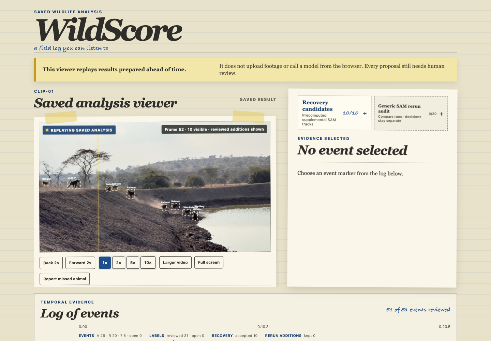
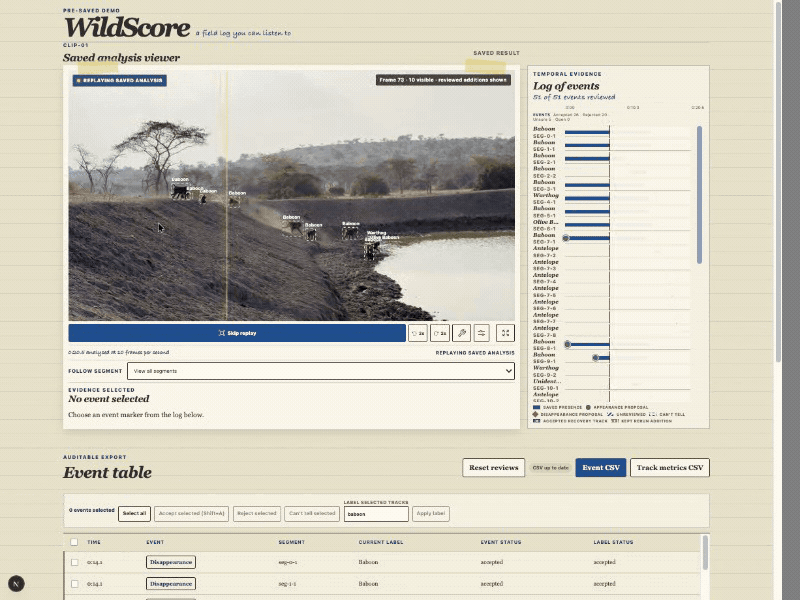

# 🎧 WildScore

### A field log you can listen to.

WildScore turns a short wildlife clip into an **evidence-linked event timeline** with optional spatial audio, so researchers can find, verify and export animal events—and see exactly what the model saw.

> **Built entirely during the Meta Global AI Developer Hackathon.** The processing pipeline uses **Meta SAM 3.1** and **Muse Spark 1.3**.
>
> **Track: Build for Your World.** A problem I know firsthand: working in biodiversity research, I've seen wildlife footage outgrow the people who have to review it.

[](https://github.com/phybuilds/WildScore/actions/workflows/ci.yml)
[](https://wildscore-demo.pages.dev/)



*Review model proposals by sight and sound, then keep the full decision trail.*

## The problem


*Crowding and occlusion break tracks; a final count cannot explain what the model saw.*

Wildlife is declining fast: WWF's *Living Planet Report 2026* finds an average **73% fall** in monitored wildlife population sizes since 1970.[1] Understanding where and when animals appear requires field evidence—but collecting footage is only the first step.

**The bottleneck is review, not recording.** Camera-trap arrays produce thousands to millions of images that take significant effort to review.[2] AI is closing that gap for still-image species identification: a 2026 study found that occupancy models built from an automated MegaDetector and SpeciesNet pipeline were remarkably similar to expert-based models for most mammal species, with the clearest divergence among rarely detected species.[3] Crowded wildlife video remains difficult to review:

- animals overlap or disappear behind vegetation;
- one animal may be split into several tracks;
- small or distant animals may be missed;
- camera movement can create misleading boundaries; and
- a final count does not explain what the model actually saw.

WildScore's answer is collaborative verification, not automated perfection: **the model proposes, the human decides, and every decision stays auditable.**

## See it work



*Select an event, hear its spatial cue, inspect the evidence and record a decision.*

1. Replay the saved SAM 3.1 and Muse Spark 1.3 result—no live inference.
2. Select a track or event to jump to its source frame and hear its cue.
3. Accept, reject or mark the proposal **Can't tell**; correct labels separately.
4. Review supplemental recovery tracks without silently merging identities.
5. Export the complete decision ledger or descriptive track metrics as CSV.

The step-by-step judge path is in [the demo guide](docs/DEMO_GUIDE.md).

## Quickstart

### **Keyless Playground Demo**

Judges can interact with the spatial-audio review cockpit in **under 60 seconds**, without generating or configuring an API key. The viewer replays committed, integrity-checked fixtures; it does not contact the Meta API.

**Easiest:** open the [hosted demo](https://wildscore-demo.pages.dev/).

### Run it locally

Requires Node.js 24.22.1 and npm 11.19.1, pinned in the repository.

```bash
git clone https://github.com/phybuilds/WildScore.git
cd WildScore
npm ci --ignore-scripts
npm run build:bundle && npm run dev
```

`build:bundle` verifies the hashes of the committed demo bundle. `dev` binds to `127.0.0.1`; neither command needs `MODEL_API_KEY`, ffmpeg or a model call.

### Docker (review viewer, no API key)

```bash
docker build -t wildscore .
docker run --rm -p 127.0.0.1:8080:8080 wildscore
```

Open <http://127.0.0.1:8080>. The multi-stage image runs as a non-root user and serves only the static viewer plus the approved 6.3 MB demo excerpt. It contains no analysis pipeline, ffmpeg, Node application dependencies, API key, `private/` directory or private/source footage.

Verified locally from a clean Docker context: the image builds, becomes healthy, serves `/` and the held-out wolf image with HTTP 200, supports video byte ranges, exposes no `MODEL_API_KEY`, and contains no `private/` path.

### Tests and CI

```bash
npm test && npm run typecheck && npm run build
```

`.github/workflows/ci.yml` is configured to run `npm ci --ignore-scripts`, the full test suite, type-checking and the production build on every push and pull request with read-only repository permissions and no secrets. A second job builds the Docker image, inspects the static-only boundary and smoke-tests HTTP 200. The CI badge will be added only after the workflow is green on `main`.

## Pilot case study


*Machine proposals remain separate from reviewer decisions and recovery evidence.*

Two people reviewed the same crowded waterhole clip in a small exploratory comparison—not an accuracy benchmark.

| | Manual review | WildScore-assisted review |
| :--- | :---: | :---: |
| **Events logged / accepted** | 22 | 30 |
| **Review time** | 34.5 min | 6 min |

The **30 accepted events overall** comprise 26 accepted core event proposals plus four accepted recovery tracks that supplied eligible event evidence. Six other accepted recovery tracks improve visible track coverage but are not added to the event total. No adjudicated reference count was established, so these figures describe the two review logs rather than recall, precision or accuracy.

## Evidence and validation

### Held-out pipeline check


Two eligible boundary events matched with **zero misses and zero false alarms**. The Muse Spark label matched the frozen reference. This is one short, static, uncrowded wolf clip—a pipeline check, not a general accuracy estimate.

### Supplemental recovery tracks


The crowded development clip contains 51 core event proposals and 10 manually accepted supplemental recovery tracks. Recovery evidence is deliberately additive: it makes SAM 3.1 failures inspectable without rewriting the original model output or pretending fragmented tracks are one animal.

## Known model limitations

| Observed failure | What happens | WildScore response |
| :--- | :--- | :--- |
| **Overcrowding** | Nearby animals compete for track identity; small animals may be missed. | Show the original proposal and let a reviewer add recovery evidence. |
| **Animal/background blending** | SAM 3.1 can fracture one visible animal into multiple short tracks when texture and foliage merge. | Keep track fragments separate unless a person reviews them; never silently merge identity. |
| **Occlusion** | Animals disappear behind vegetation or other animals, ending a track early. | Jump back to the exact boundary frame and record accepted, rejected or uncertain decisions. |
| **Camera motion** | Panning can create or hide apparent boundary events. | Treat entries and exits as proposals, not biological visit counts. |
| **Free-text labels** | Muse Spark labels are visual proposals, not calibrated confidence scores. | Store label review separately; omit a misleading cross-stage confidence column. |

Supplemental recovery tracks are not a cosmetic patch. They demonstrate the engineering boundary: preserve the failed baseline, add human-reviewed evidence, and favour scientific traceability over an over-promised automated count.

## How it works


*Saved SAM tracking in a second environment; a capability example, not an accuracy test.*

```text
local video
  → ffprobe validation and bounded, metadata-stripped derivative
  → Meta SAM 3.1 geometry and tracks
  → deterministic presence and boundary-event proposals
  → bounded Muse Spark 1.3 visual label evidence
  → validated private bundle
  → static review viewer and defensive CSV exports
```

The CLI uses argument arrays rather than shell interpolation, pins the Meta API host, caps duration and calls, checkpoints resumable stages, validates provider output and confirms remote input deletion after SAM. If Spark fails, the geometry timeline remains reviewable with unlabelled tracks.

## Architecture

### Visual-spatial event anchors

SAM geometry fixes appearance and disappearance proposals to frames. WildScore derives horizontal position from the event's box and maps it to `-1`, `0` or `+1` for left, centre or right:

```ts
const boxCenterX = (box.left + box.right) / 2;
const pan = boxCenterX < width / 3 ? -1 : boxCenterX > 2 * width / 3 ? 1 : 0;
```

The Web Audio stereo panner applies an equal-power sound field. With normalized pan position \(X_n=(pan+1)/2\):

\[
G_{left}=\cos\left(\frac{\pi}{2}X_n\right)
\]

\[
G_{right}=\sin\left(\frac{\pi}{2}X_n\right)
\]

Appearance cues rise; disappearance cues fall. Rejected and uncertain events are silent, and simultaneous cues are voice-limited so a crowded frame does not become an unusable wall of sound. See [`src/audio/cue-builder.ts`](src/audio/cue-builder.ts).

### Data and privacy layers

1. **Private analysis:** source video, provider output and run bundles stay under ignored `private/` storage.
2. **Read-only proposal pool:** SAM geometry and Muse Spark label proposals remain the saved baseline.
3. **Human decision layer:** event, label, recovery and rerun-audit decisions are stored separately.
4. **Public viewer:** the static export has no upload endpoint, API route, inference proxy or secret.
5. **Defensive export:** CSV includes rejected and uncertain proposals and neutralises spreadsheet-formula prefixes.

### Repo layout

| Path | Purpose |
| :--- | :--- |
| `bin/wildscore.mjs` | Keyless demo, environment doctor, bounded analysis and private-run viewer CLI |
| `scripts/` | Saved-fixture preparation, Meta feasibility stages and deterministic bundle tools |
| `src/` | Schemas, Meta clients, event derivation, review state, audio scheduling and safe exports |
| `web/` | Static review viewer; no upload or inference endpoint |
| `docs/DEMO_GUIDE.md` | Short evidence-led judge walkthrough |
| `Dockerfile` / `.dockerignore` | Non-root static viewer image and strict build-context boundary |
| `.github/workflows/ci.yml` | Secret-free test/build job and Docker boundary smoke test |
| `.env.example` | Name-only template for the local `MODEL_API_KEY` |
| `.node-version` | Pinned Node.js version |

## Analyse your own footage

Private analysis additionally requires ffmpeg/ffprobe 8.0.3 or a later reviewed patched release and a Meta Model API key in ignored `.env.local` storage.

```bash
node --env-file=.env.local bin/wildscore.mjs doctor
node --env-file=.env.local bin/wildscore.mjs analyse /path/to/clip.mp4 --dry-run --max-seconds 30 --max-calls 8
node --env-file=.env.local bin/wildscore.mjs analyse /path/to/clip.mp4 --full --yes --max-seconds 30 --max-calls 8
```

## Privacy and safety

- `MODEL_API_KEY` is process-local: never a CLI argument, browser variable, committed value or log field.
- Source media is re-encoded locally with metadata removed before a model call.
- Remote media deletion is confirmed after the SAM stage.
- Private media, raw provider responses and run bundles stay under git-ignored `private/` storage.
- Public output is scanned for credentials, environment files, personal paths and private-run data.
- The Docker runtime contains only static public output and runs as non-root UID 101.

## What's next

Only Meta models are used in the processing pipeline for this build. From easiest to hardest after the hackathon:

1. **Scientific names:** common names to binomials (*Papio anubis*, not “baboon”), with a toggle.
2. **Location-bounded context:** optional country species lists to constrain label proposals.
3. **Interaction flags:** cluster overlapping events into candidate social or predation events for review.
4. **In-app prompt tuning:** one-click prompt refinement from reviewer feedback.
5. **Optional integrations:** comparison layers such as SpeciesNet, preserving local-first and human-review rules.

## References

[1]: https://www.worldwildlife.org/publications/2026-living-planet-report/ "WWF, Living Planet Report 2026"
[2]: https://munin.uit.no/handle/10037/34526 "Celis et al., 2024"
[3]: https://besjournals.onlinelibrary.wiley.com/doi/10.1111/1365-2664.70370 "Thornton et al., 2026"

*WildScore does not claim to solve wildlife monitoring. It gives researchers a faster, more honest way to see what the model saw—and correct it.*
