# 🎧 WildScore

### A field log you can listen to.

WildScore turns a short wildlife clip into an **evidence-linked event timeline** with optional spatial audio, so researchers can find, verify and export animal events—and see exactly what the model saw.

> **Built entirely during the Meta Global AI Developer Hackathon.** The processing pipeline uses **Meta SAM 3.1** and **Muse Spark 1.3**.
>
> **Track: Build for Your World.** A problem I know firsthand: working in biodiversity research, I've seen wildlife footage outgrow the people who have to review it.

[](https://github.com/phybuilds/WildScore/actions/workflows/ci.yml)
[](https://wildscore-demo.pages.dev/)

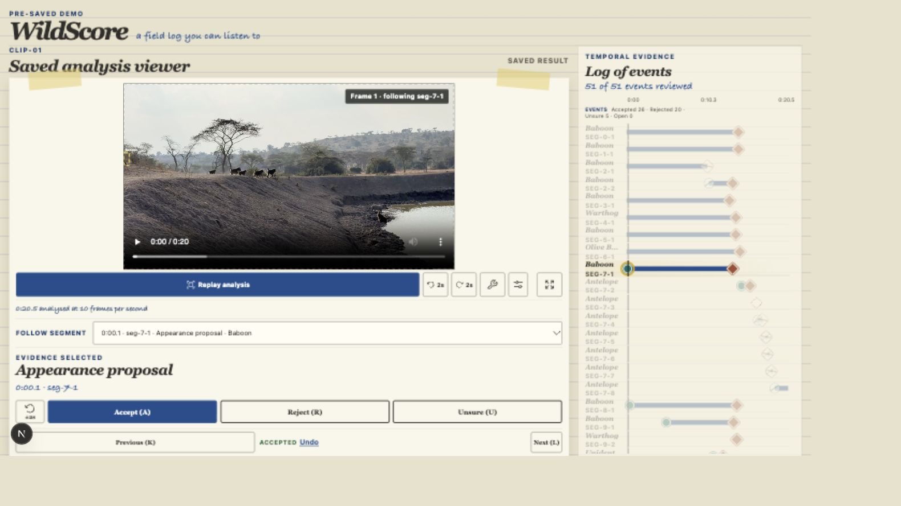

<sub><em><strong>Figure 1.</strong> Review proposals by sight and sound while preserving the decision trail. Source: WildScore interface and project field footage; CC BY-NC 4.0.</em></sub>

## The problem

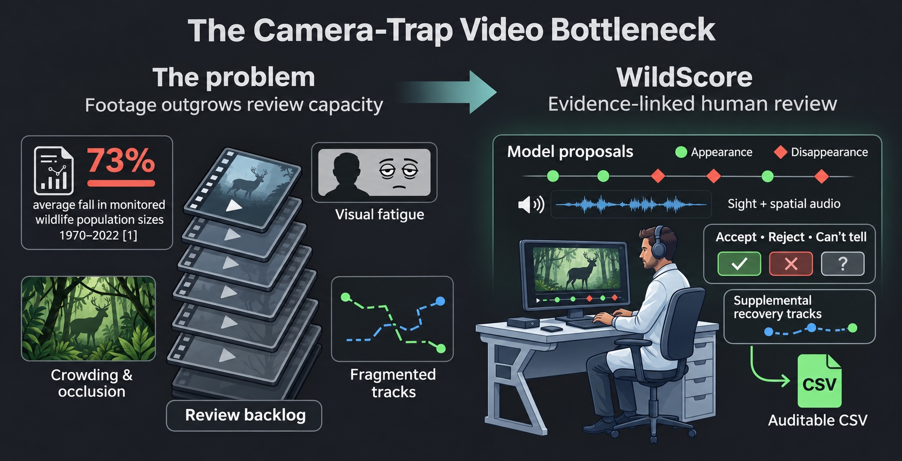

<sub><em><strong>Figure 2.</strong> Footage outgrows review capacity; WildScore makes model proposals inspectable. Source: AI-generated infographic, edited against project evidence; CC BY-NC 4.0.</em></sub>

Wildlife is declining fast: WWF's *Living Planet Report 2026* finds an average **73% fall** in monitored wildlife population sizes since 1970 [[1]](#reference-1). Understanding where and when animals appear requires field evidence—but collecting footage is only the first step.

**The bottleneck is review, not recording.** Camera-traps can produce millions of images that take significant effort to review [[2]](#reference-2). AI is closing that gap for still-image species identification [[3]](#reference-3), but crowded wildlife videos remain challenging to review:

- animals overlap or disappear behind vegetation;
- one animal may be split into several tracks;
- small or distant animals may be missed;
- camera movement can create misleading boundaries; and
- a final count does not explain what the model actually saw.

### How WildScore steps in

**WildScore's answer is collaborative verification, not automated perfection.** The model proposes, the human decides, and every decision is logged.

<sub><em><strong>Table 1.</strong> How WildScore addresses the three review bottlenecks.</em></sub>

| The gap | What WildScore does |
| :--- | :--- |
| Too much footage to watch | SAM 3.1 proposes when animals appear and disappear, and Muse Spark 1.3 adds bounded labels, so the reviewer starts from evidence-linked proposals instead of raw footage. |
| Fatigue and missed events | A sound plays on each appearance and disappearance, panned left or right to where it happened. Recovery tracks let the reviewer add animals the model missed. |
| A black-box count cannot be trusted | Every suggestion links to its frame, every human decision is stored separately, and accepted, rejected and uncertain proposals remain in an auditable CSV. |

## See it work

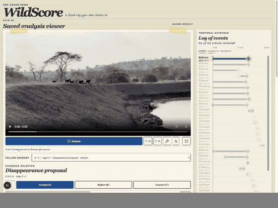

<sub><em><strong>Figure 3.</strong> Select an event, hear its spatial cue, inspect the evidence and decide. Source: WildScore interface and project field footage; CC BY-NC 4.0.</em></sub>

### The workflow in five steps

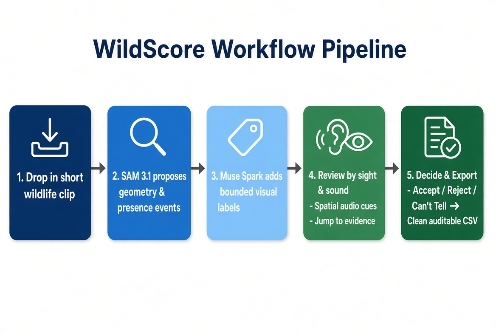

<sub><em><strong>Figure 4.</strong> SAM proposes, Muse Spark adds bounded labels, and the reviewer decides. Source: AI-generated workflow graphic, edited for project accuracy; CC BY-NC 4.0.</em></sub>

1. Replay the saved SAM 3.1 and Muse Spark 1.3 result—no live inference.
2. Select a track or event to jump to its source frame and hear its cue.
3. Accept, reject or mark the proposal **Can't tell**; correct labels separately.
4. Review supplemental recovery tracks without silently merging identities.
5. Export the complete decision ledger or descriptive track metrics as CSV.

The step-by-step user path is in [the demo guide](docs/DEMO_GUIDE.md).

### Meta stack

Every model in the WildScore processing pipeline is a Meta model, including when the saved demo results are generated.

<sub><em><strong>Table 2.</strong> Meta models and tools used by WildScore.</em></sub>

| Meta model or tool | Model ID | Role in WildScore | Public verification |
| :--- | :--- | :--- | :--- |
| **SAM 3.1** | `sam-3.1` | Segments and tracks visible animals; deterministic code derives appearance and disappearance proposals from its geometry. | [`src/cli/meta-sam-run.mjs`](src/cli/meta-sam-run.mjs) and [`scripts/build-result-bundle.mjs`](scripts/build-result-bundle.mjs) |
| **Muse Spark 1.3** | `muse-spark-1.3` | Reviews selected frames and writes bounded text-label evidence for separate human review. | [`src/cli/spark-label-stage.mjs`](src/cli/spark-label-stage.mjs) and [`scripts/meta-spark-label.mjs`](scripts/meta-spark-label.mjs) |
| **Muse Code** | Not recorded in the public runtime | Assisted with bounded implementation tasks during the hackathon; it is not part of the processing pipeline. | No runtime, performance or quantitative usage claim is made. |

SAM and Muse Spark calls go through the Meta Model API. The key remains process-local; no fine-tuned or open-weight model is used. Provider-reported usage remains in private run records and is not presented as billing or performance evidence.

## Quickstart

### **Keyless Demo (no API key needed)**
**Easiest:** open the [hosted demo](https://wildscore-demo.pages.dev/).

### Run it locally
```bash
git clone https://github.com/phybuilds/WildScore.git
cd WildScore
npm ci --ignore-scripts
npm run build:bundle && npm run dev
```
Opens on <http://127.0.0.1:3000> (or the port shown).


### Docker (static viewer only)
```bash
docker build -t wildscore .
docker run --rm -p 127.0.0.1:8080:8080 wildscore
```

Open <http://127.0.0.1:8080>. The multi-stage image runs as a non-root user and serves only the static viewer plus the approved 6.3 MB demo excerpt. 

### Tests and CI

```bash
npm test && npm run typecheck && npm run build
```

`.github/workflows/ci.yml` runs `npm ci --ignore-scripts`, the full test suite, type-checking and the production build on every push and pull request with read-only repository permissions and no secrets. A second job builds the Docker image, inspects the static-only boundary and smoke-tests HTTP 200. The badge above reports the workflow on `main`.

### Analyse your own footage (requires Meta API key)
Requires ffmpeg/ffprobe 8.0.3 or a later reviewed patched release and a Meta Model API key stored in ignored `.env.local` storage.

```bash
node --env-file=.env.local bin/wildscore.mjs doctor
node --env-file=.env.local bin/wildscore.mjs analyse /path/to/clip.mp4 --dry-run --max-seconds 30 --max-calls 8
node --env-file=.env.local bin/wildscore.mjs analyse /path/to/clip.mp4 --full --yes --max-seconds 30 --max-calls 8
```

## Pilot case study

Two users reviewed the same crowded waterhole clip in a small exploratory comparison—not an accuracy benchmark.

<sub><em><strong>Table 3.</strong> Manual and WildScore-assisted review logs for the same clip.</em></sub>

| | Manual review | WildScore-assisted review |
| :--- | :---: | :---: |
| **Events logged / accepted** | 22 | 30 |
| **Review time** | 34.5 min | 6 min |
| **Notable misses** | Unidentified birds, warthog, and several baboon and antelope events | Not established without an adjudicated reference count |

The **30 accepted events** comprise 26 core proposals accepted by the reviewer plus four recovery tracks with eligible event evidence. Six other accepted recovery tracks improved visible coverage without changing the event total. With no adjudicated reference count, this compares review logs—not recall, precision or accuracy.

**Takeaway:** WildScore’s proposals surfaced events that were absent from the manual log, and every machine suggestion stayed auditable. This is a small exploratory pilot (one clip, two users), not an accuracy benchmark.
One possible explanation is reviewer fatigue on a crowded scene, which this pilot can’t test.

## Evidence and validation

### Held-out pipeline check

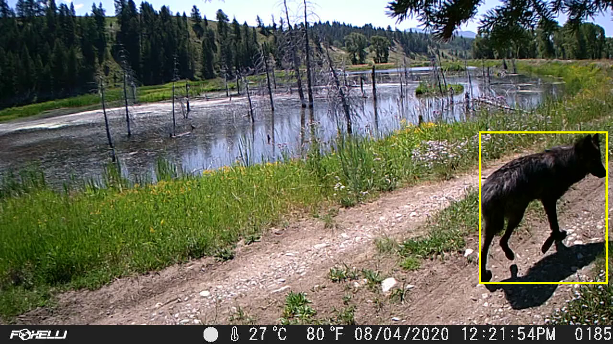

<sub><em><strong>Figure 5.</strong> Held-out wolf frame with the saved SAM boundary. Source footage: USFWS Mountain-Prairie, public domain; overlay: WildScore, CC BY-NC 4.0.</em></sub>

Two eligible boundary events matched with **zero misses and zero false alarms**. The Muse Spark label matched the frozen reference. This is one short, static, uncrowded wolf clip—a pipeline check, not a general accuracy estimate.

### Supplemental recovery tracks

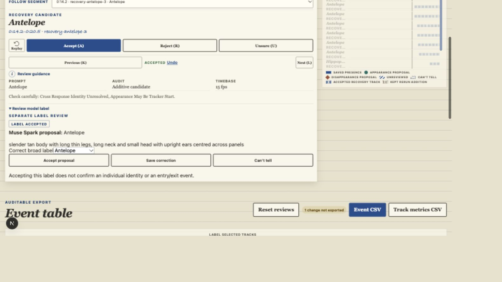

<sub><em><strong>Figure 6.</strong> Supplemental recovery remains separate from the original model proposal. Source: WildScore interface and project field footage; CC BY-NC 4.0.</em></sub>

The crowded development clip contains 51 core event proposals (26 accepted, 20 rejected and 5 marked Unsure by the reviewer) and 10 manually accepted supplemental recovery tracks. Rejections were attributed to camera motion, possible occlusion, detection failure and track fragmentation (see [Table 4](#table-4)). Recovery evidence is deliberately additive: it makes SAM 3.1 failures inspectable without rewriting the original model output or pretending fragmented tracks are one animal.

### SAM tracking in another environment

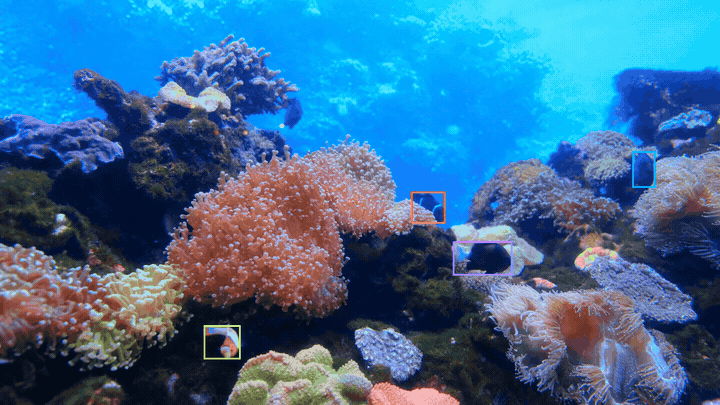

<sub><em><strong>Figure 7.</strong> Saved SAM tracking in a second environment; a capability example, not an accuracy test. Source footage: third-party licensed; source licence retained. Overlay: WildScore, CC BY-NC 4.0.</em></sub>

## Known model limitations

<table>
  <tr>
    <td width="50%">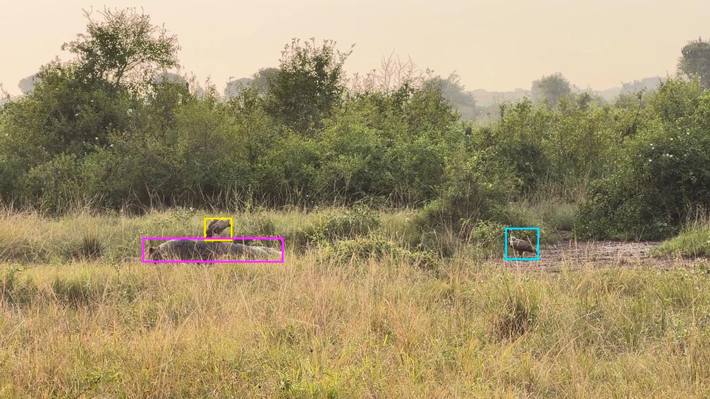</td>
    <td width="50%">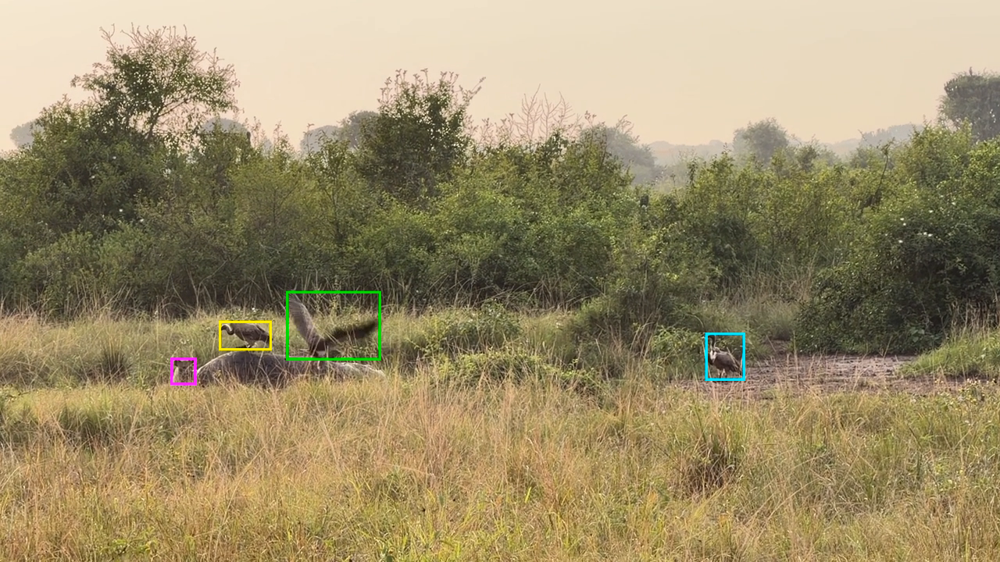</td>
  </tr>
  <tr>
    <td><sub><em><strong>Figure 8a.</strong> Crowding can merge nearby subjects into one boundary; here, the hyena merges with the carcass. Source: WildScore evaluation footage; CC BY-NC 4.0.</em></sub></td>
    <td><sub><em><strong>Figure 8b.</strong> Earlier in the same clip, SAM separates four visible animals; the overlap failure is scene-dependent. Source: WildScore evaluation footage; CC BY-NC 4.0.</em></sub></td>
  </tr>
</table>

<a id="table-4"></a>
<sub><em><strong>Table 4.</strong> Observed model limitations and WildScore's review response.</em></sub>

| Observed failure | What happens | WildScore response |
| :--- | :--- | :--- |
| **Overcrowding** | Nearby animals compete for track identity; small animals may be missed. | Show the original proposal and let a reviewer add recovery evidence. |
| **Animal/background blending** | SAM 3.1 can fracture one visible animal into multiple short tracks when texture and foliage merge. | Keep track fragments separate unless a person reviews them; never silently merge identity. |
| **Occlusion** | Animals disappear behind vegetation or other animals, ending a track early. | Jump back to the exact boundary frame and record accepted, rejected or uncertain decisions. |
| **Camera motion** | Panning can create or hide apparent boundary events. | Treat entries and exits as proposals, not biological visit counts. |
| **Free-text labels** | Muse Spark labels are visual proposals, not calibrated confidence scores. | Store label review separately; omit a misleading cross-stage confidence column. |

Supplemental recovery tracks are not a cosmetic patch. They demonstrate the engineering boundary: preserve the failed baseline, add human-reviewed evidence, and favour scientific traceability over an over-promised automated count.

## How it works

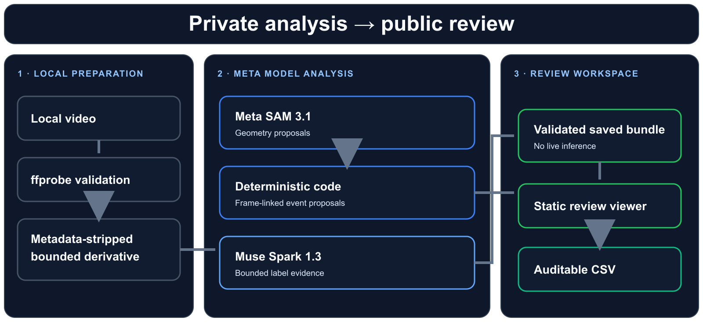

<sub><em><strong>Figure 9.</strong> Private analysis produces a validated bundle for public, keyless review. Source: AI-generated architecture graphic, edited against the implementation; CC BY-NC 4.0.</em></sub>

1. **Local-first.** Raw footage is validated and re-encoded locally with metadata stripped before the bounded derivative is sent for a model call.
2. **Deterministic anchors.** SAM geometry fixes presence bounds to specific frames, so every human decision remains linked to stable evidence.
3. **Audit-ready output.** The final bundle exports a defensive CSV built for scientific review records.

The CLI uses argument arrays rather than shell interpolation, pins the Meta API host, caps duration and calls, checkpoints resumable stages, validates provider output and confirms remote input deletion after SAM. If Spark fails, the geometry timeline remains reviewable with unlabelled tracks.

## Architecture

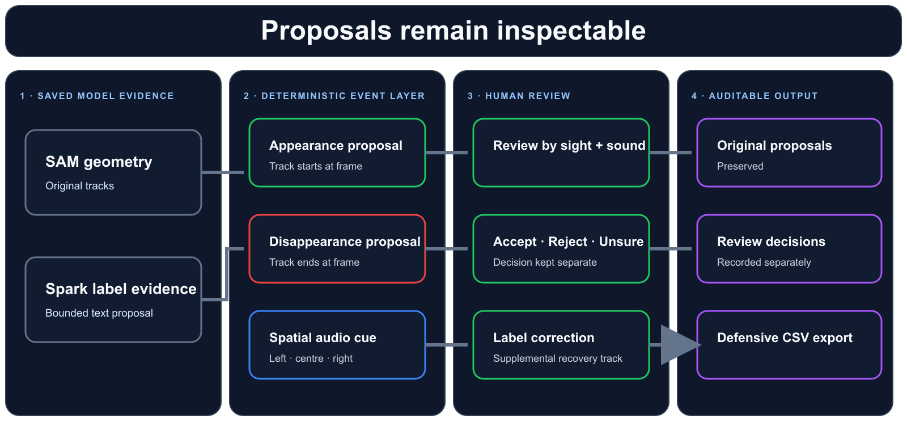

<sub><em><strong>Figure 10.</strong> Machine proposals remain inspectable while reviewer decisions and recovery evidence stay separate. Source: AI-generated architecture graphic, edited against the implementation; CC BY-NC 4.0.</em></sub>

### Event anchors

- 🟢 **Appearance (green circle):** a new track starts. WildScore records the frame and spatial position where the tracked subject first appears.
- 🔴 **Disappearance (red diamond):** a track ends. WildScore records the final frame and spatial position; this remains a review proposal, not a biological claim that the animal left the site.

### Event-triggered spatial audio

SAM geometry fixes appearance and disappearance proposals to frames. WildScore derives horizontal position from the event's box and maps it to `-1`, `0` or `+1` for left, centre or right:

```ts
const boxCenterX = (box.left + box.right) / 2;
const pan = boxCenterX < width / 3 ? -1 : boxCenterX > 2 * width / 3 ? 1 : 0;
```

The Web Audio stereo panner applies an equal-power sound field. With normalized pan position \(X_n=(pan+1)/2\):

\[
G_{left}=\cos\left(\frac{\pi}{2}X_n\right)
\]

\[
G_{right}=\sin\left(\frac{\pi}{2}X_n\right)
\]

Appearance cues rise; disappearance cues fall. Rejected and uncertain events are silent, and simultaneous cues are voice-limited so a crowded frame does not become an unusable wall of sound. See [`src/audio/cue-builder.ts`](src/audio/cue-builder.ts).

### Data and privacy layers

1. **Private analysis:** source video, provider output and run bundles stay under ignored `private/` storage.
2. **Read-only proposal pool:** SAM geometry and Muse Spark label proposals remain the saved baseline.
3. **Human decision layer:** event, label, recovery and rerun-audit decisions are stored separately.
4. **Public viewer:** the static export has no upload endpoint, API route, inference proxy or secret.
5. **Defensive export:** CSV includes rejected and uncertain proposals and neutralises spreadsheet-formula prefixes.

### Privacy and safety

- `MODEL_API_KEY` is process-local: never a CLI argument, browser variable, committed value or log field.
- Source media is re-encoded locally with metadata removed before a model call.
- Remote media deletion is confirmed after the SAM stage.
- Private media, raw provider responses and run bundles stay under git-ignored `private/` storage.
- Public output is scanned for credentials, environment files, personal paths and private-run data.
- The Docker runtime contains only static public output and runs as non-root UID 101.

### Repo layout

<sub><em><strong>Table 5.</strong> Public repository structure and responsibility boundaries.</em></sub>

| Path | Purpose |
| :--- | :--- |
| `bin/wildscore.mjs` | Keyless demo, environment doctor, bounded analysis and private-run viewer CLI |
| `scripts/` | Saved-fixture preparation, Meta feasibility stages and deterministic bundle tools |
| `src/` | Schemas, Meta clients, event derivation, review state, audio scheduling and safe exports |
| `web/` | Static review viewer; no upload or inference endpoint |
| `docs/DEMO_GUIDE.md` | Short evidence-led user walkthrough |
| `Dockerfile` / `.dockerignore` | Non-root static viewer image and strict build-context boundary |
| `.github/workflows/ci.yml` | Secret-free test/build job and Docker boundary smoke test |
| `.env.example` | Name-only template for the local `MODEL_API_KEY` |
| `.node-version` | Pinned Node.js version |
| `LICENSE` / `LICENSE-MEDIA.md` | Apache-2.0 code licence and CC BY-NC 4.0 media terms |

## Post-hackathon stretch goals

Only Meta models are used in the processing pipeline for this build. Stretch goals after the hackathon:

1. **Scientific names:** common names to binomials (*Papio anubis*, not “baboon”), with a toggle.
2. **Location-bounded context:** optional country species lists to constrain label proposals.
3. **Interaction flags:** cluster overlapping events into candidate social or predation events for review.
4. **In-app prompt tuning:** one-click prompt refinement from reviewer feedback.
5. **Optional integrations:** comparison layers such as SpeciesNet, preserving local-first and human-review rules.

## References

1. <a id="reference-1"></a>WWF. [*Living Planet Report 2026*](https://www.worldwildlife.org/publications/2026-living-planet-report/).
2. <a id="reference-2"></a>Celis et al. (2024). [Camera-trap review research record](https://munin.uit.no/handle/10037/34526).
3. <a id="reference-3"></a>Thornton et al. (2026). [Automated MegaDetector and SpeciesNet occupancy study](https://besjournals.onlinelibrary.wiley.com/doi/10.1111/1365-2664.70370).

## License

WildScore uses a dual-license strategy:

- **Codebase and pipeline core:** [Apache License 2.0](LICENSE). Third-party dependencies and Meta model services retain their own terms.
- **WildScore-owned multimedia and documentation graphics:** [Creative Commons Attribution-NonCommercial 4.0 International](LICENSE-MEDIA.md). Attribute them to the **WildScore project**.
- **Third-party media:** retains its original licence. The held-out USFWS wolf footage is public domain; the coral-reef source footage remains under its source licence, while WildScore's overlays and annotations are CC BY-NC 4.0.

*WildScore does not claim to solve wildlife monitoring. It gives researchers a faster, more honest way to see what the model saw—and correct it.*
