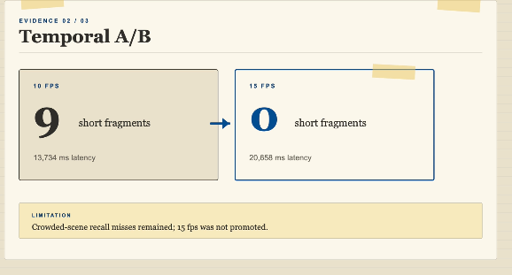
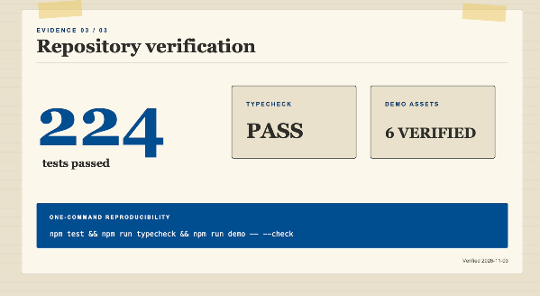

# WildScore evaluation summary

WildScore was evaluated as an evidence-led review workflow, not as a general wildlife-identification benchmark. The checks below separate exploratory user timing, deterministic event accounting and a small held-out pipeline check.

## One-clip exploratory pilot

Two users reviewed the same crowded waterhole clip using different workflows.

| Review workflow | Accepted events logged | Review time |
| :--- | ---: | ---: |
| Manual review | 22 | 34.5 minutes |
| WildScore-assisted review | 30 | 6 minutes |

The WildScore total is fully accounted for: **26 reviewer-accepted core proposals + 4 accepted recovery tracks with eligible event evidence = 30 accepted events**. Six additional accepted recovery tracks improved visible coverage but did not add eligible events.

The WildScore log included unidentified birds, a warthog and several baboon and antelope events that were not present in the manual log. No adjudicated reference count was established, so these figures compare two review logs; they do **not** establish recall, precision, accuracy or a general speed-up claim.

## Held-out pipeline check

A short, static, uncrowded public-domain wolf clip was frozen as a separate pipeline fixture.

- **2/2 eligible boundary events matched** the frozen reference.
- **0 misses and 0 false alarms** occurred within those two eligible events.
- The Muse Spark label matched the frozen reference.

This verifies the saved-bundle path on one bounded fixture. It is not evidence of general model accuracy.

The recorded run measured 6,185 ms for SAM and 12,517 ms for upload plus SAM. These are single-run timings, not latency guarantees.

## Temporal sampling A/B

The same crowded development clip was processed at two sampling rates. This experiment tested temporal continuity, not animal-level accuracy.

| Saved SAM run | Frames | Presence segments | One/two-frame fragments | SAM latency |
| :--- | ---: | ---: | ---: | ---: |
| 10 fps baseline | 205 | 31 | 9 | 13,734 ms |
| 15 fps experiment | 308 | 18 | 0 | 20,658 ms |



<sub><em><strong>Evaluation figure 1.</strong> Increasing the sampling rate removed short fragments in this run but increased latency. Source: WildScore recorded evaluation; CC BY-NC 4.0.</em></sub>

A three-frame late-clip spot check still found more visible animals than SAM boxes; neither visible hippo was boxed at 18 seconds, and several background antelopes remained unboxed. Because crowded-scene recall failures remained, the 15 fps run was **not** promoted to the reviewed demo. These aggregate counts do not measure tracking accuracy, recall or identity continuity.

## Failure-focused evaluation

Crowded development footage exposed track fragmentation, occlusion, camera-motion boundaries and animal/background blending. WildScore keeps the original SAM proposal immutable and records rejection, uncertainty, label correction and supplemental recovery separately. This makes failures inspectable instead of silently rewriting them.

## Reproduce the public checks

Verified 4 November 2026:

- **224 automated tests passed** in the root `npm test` command.
- Type-checking passed.
- **Six manifest-tracked demo assets** passed integrity verification.



<sub><em><strong>Evaluation figure 2.</strong> Repository verification captured for the demo video. Source: WildScore test and integrity-check output; CC BY-NC 4.0.</em></sub>

```bash
npm ci --ignore-scripts
npm test && npm run typecheck && npm run demo -- --check
npm run build
```

The keyless demo replays saved fixtures and makes no Meta API call. The six-file integrity manifest is explained in the [demo asset inventory](../docs/DEMO_ASSETS.md). See also the [demo guide](../docs/DEMO_GUIDE.md), [CI workflow](../.github/workflows/ci.yml) and [known model limitations](../README.md#known-model-limitations).
