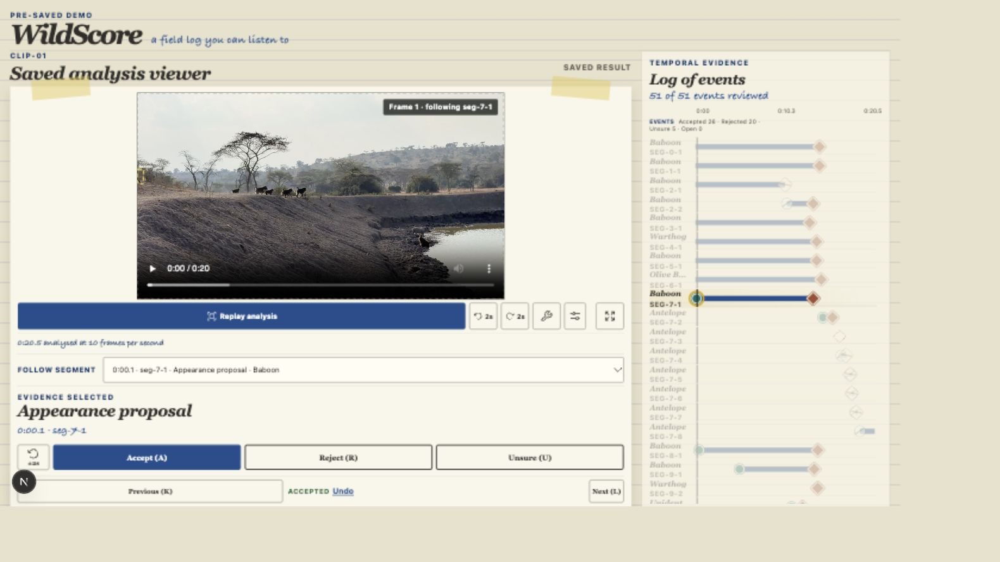
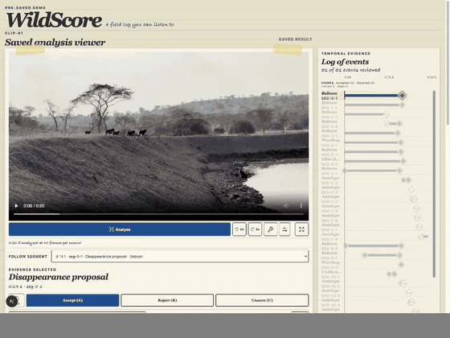
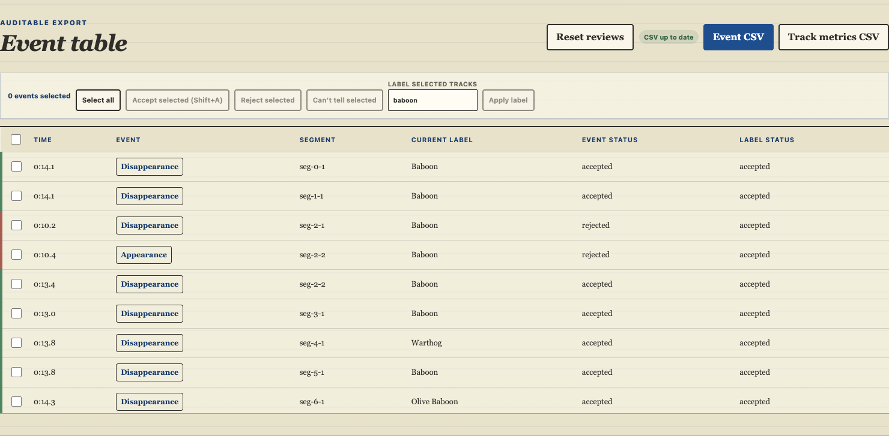

# WildScore demo assets

The keyless viewer replays a saved, integrity-checked result and makes no Meta API call. “Six demo assets verified” means the six files listed in [`web/public/demo/manifest.json`](../web/public/demo/manifest.json), excluding the manifest itself.

## What users see

<em><strong>Demo asset figure 1.</strong> Saved geometry, event proposals and review controls in the keyless viewer. Source: WildScore interface and project field footage; CC BY-NC 4.0.</em>

<em><strong>Demo asset figure 2.</strong> Selecting evidence, jumping to its frame and recording a review decision. Source: WildScore interface and project field footage; CC BY-NC 4.0.</em>

<em><strong>Demo asset figure 3.</strong> Event and label states remain visible before CSV export. Source: WildScore interface and project field footage; CC BY-NC 4.0.</em>

## The six manifest-tracked files

| Asset | Role in the keyless demo |
| :--- | :--- |
| `ATTRIBUTION.txt` | Media attribution and licence information shown with the saved demo. |
| `bundle.json` | Validated SAM geometry, deterministic events, Muse Spark label evidence and saved review state. |
| `correspondence-audit.json` | Supplemental comparison evidence kept separate from identity claims. |
| `recovery-candidates.json` | Ten human-reviewed supplemental recovery tracks and their provenance. |
| `wildscore-field-demo.mp4` | Approved 6.3 MB display excerpt used by the static viewer. |
| `wolf-heldout-boundary.png` | Public-domain held-out pipeline-check image with the saved WildScore overlay. |

`npm run build:bundle` verifies each file against its committed SHA-256 digest. The manifest contains no API key, raw provider trace or private source path. The viewer is static: it has no upload endpoint, inference proxy or live-model fallback.

For the interaction sequence, see the [demo guide](DEMO_GUIDE.md). For model and software checks, see the [evaluation summary](../bench/EVALUATION.md).
