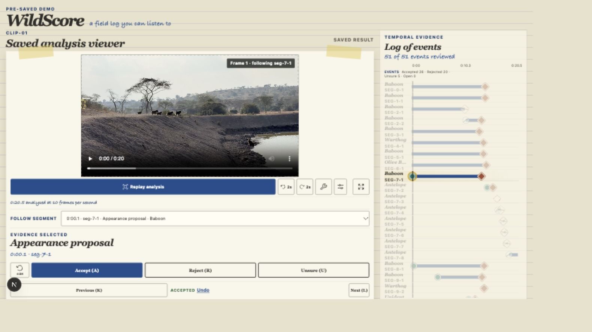
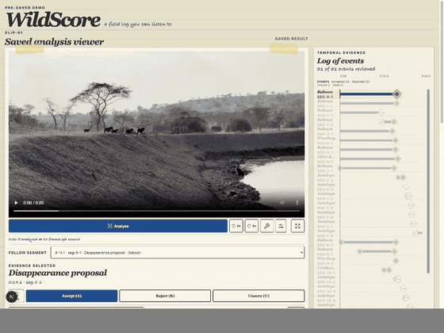
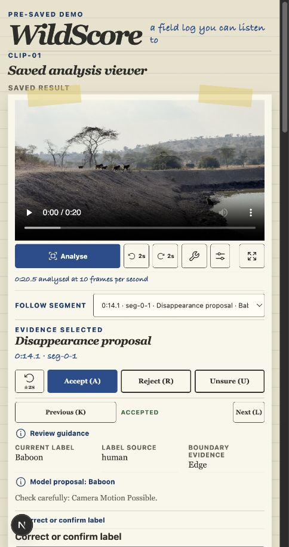
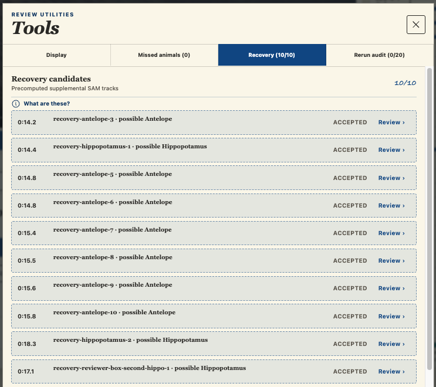
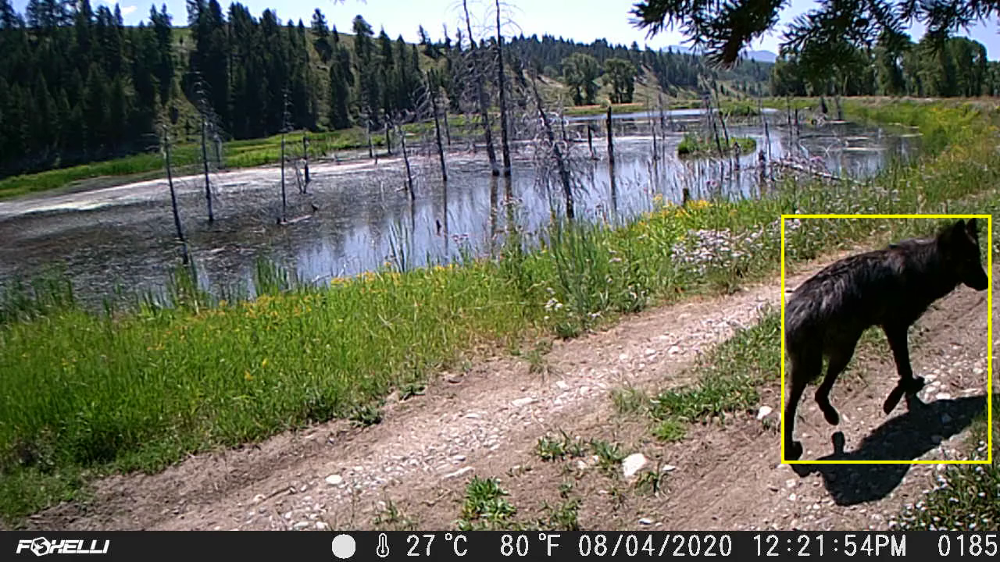

# WildScore demo guide

The hosted and local demos replay saved, integrity-checked SAM 3.1 and Muse Spark 1.3 output. They make no model call and need no API key.

## 1. Start the saved replay

Open the viewer and select **Analyse**. The video, track layers and event timeline load from the committed bundle.

<em><strong>Demo figure 1.</strong> Current saved-analysis workspace. Source: WildScore interface and project field footage; CC BY-NC 4.0.</em>

## 2. Inspect an event by sight and sound

Select an appearance or disappearance proposal. WildScore jumps to its evidence frame and plays a left-, centre-, or right-panned cue based on the saved geometry.

<em><strong>Demo figure 2.</strong> Selecting an event jumps to its saved evidence. Source: WildScore interface and project field footage; CC BY-NC 4.0.</em>

## 3. Record a decision

Choose **Accept**, **Reject** or **Unsure**. Event decisions and label corrections are stored separately from the machine proposal.

<em><strong>Demo figure 3.</strong> A human decision remains separate from the model proposal. Source: WildScore interface and project field footage; CC BY-NC 4.0.</em>

## 4. Inspect model failure and recovery

Open recovery review to see supplemental tracks. These additions improve visible coverage without overwriting the SAM baseline or silently merging identities.

<em><strong>Demo figure 4.</strong> Accepted recovery candidates remain supplemental evidence. Source: WildScore interface and project field footage; CC BY-NC 4.0.</em>

## 5. Check evidence and export

The Evidence section shows the bounded held-out wolf result. Export the event ledger to confirm that proposed, accepted, rejected and uncertain records remain present.

<em><strong>Demo figure 5.</strong> Held-out wolf boundary evidence. Source footage: USFWS Mountain-Prairie, public domain; overlay: WildScore, CC BY-NC 4.0.</em>
